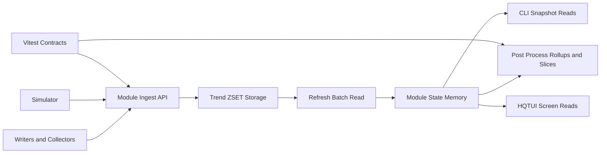

# Image Ops Observability System Reference

Status: active
Last updated: 2026-11-05

## Purpose

This doc set is the canonical reference for the Image Ops metric pipeline.

It defines:

1. How metrics are defined and governed.
2. How samples are ingested.
3. How trend/slice data is generated.
4. How state is retrieved through the module interface.
5. How CLI and HQTUI consume module state.
6. How simulator and tests enforce coverage and contracts.

## Design Rules

1. Metrics are predefined, not dynamic.
2. Metric identity is name plus key, controlled by registries.
3. Ingestion must reject unregistered metric keys.
4. Sampling, slicing, and UI reads are registry-driven.
5. Module APIs are the source of truth for callers.

## Core Documents

1. Module Interface: ./image-ops-module-interface-reference.md
2. Metric Registry and Catalog: ./image-ops-metric-registry-and-catalog.md
3. Sampling, Collectors, Slices, and Timing: ./image-ops-sampling-collectors-and-slices.md
4. CLI and HQTUI Integration: ./image-ops-cli-ui-integration.md
5. Simulator, Harnesses, and Vitest Coverage: ./image-ops-testing-simulator-and-harnesses.md

## Related Existing Docs

1. Metrics Inventory: ./image-ops-metrics-inventory.md
2. Control Tower Notes: ./image-ops-control-tower-notes.md
3. Redis Metric Key Convention: ./redis-metrics-key-convention.md

## Dataflow Summary

## Source Files

1. src/lib/workers/image-ops-control-module.ts
2. src/lib/workers/image-metrics-registry.ts
3. src/lib/workers/image-job-metric-trends.ts
4. src/lib/workers/image-ops-data-simulator.ts
5. src/lib/scripts/run-image-ops-cli.ts
6. src/lib/scripts/run-image-ops-hqtui.ts
